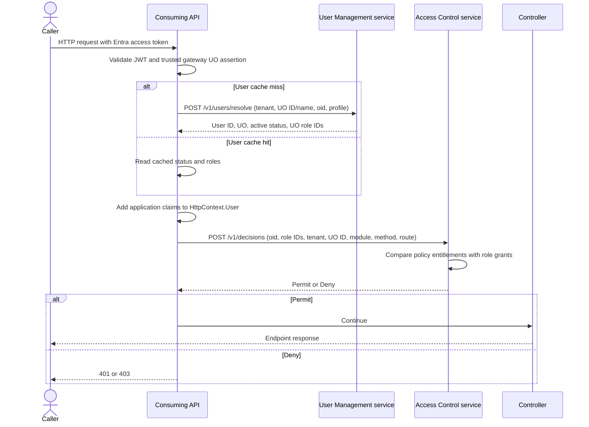

# Access Control and User Management

This .NET 10 solution provides two services and two reusable ASP.NET Core client packages. **User Management** owns tenant-scoped users, unit organizations (UOs), role definitions, and assignments. **Access Control** owns endpoint policies and entitlements granted to stable role IDs within a tenant and UO. A consuming API installs both client packages to enrich the current request and decide whether its controller may run. The solution has no Asseco dependency.

The two services do **not** call each other. The consuming API connects them:



## What each component does

| Component | Responsibility | Data it owns or changes |
|---|---|---|
| `UserManagement.Service` | Finds a user by application tenant and Entra `oid`; creates a missing UO when the trusted gateway asserts a new ID and name; assigns a first-time user the UO's `reviewer` role; exposes administrator endpoints for UOs, roles, assignments, and user status. | Its own SQL Server database, `UserManagementRolesLocalDev` in local Development. It does not validate the end-user JWT; the consuming API validates it first. |
| `UserManagement.Client` NuGet | Runs after authentication, reads the validated `oid` and gateway-authenticated UO identity, calls User Management on a cache miss, denies inactive users, and adds user, tenant, UO, role-ID, and role-code claims to `HttpContext.User`. | A bounded, per-instance cache keyed by tenant, UO ID, and `oid`. It changes the principal for **this request only**; it does not edit or reissue the JWT. |
| `AccessControl.Service` | Looks up the policy for a tenant, UO ID, module, HTTP method, and route template; compares required entitlements with grants for the supplied role IDs; returns Permit or Deny. Administrator endpoints manage policies and grants. | Its own SQL Server database, `AccessControlEntitlementsLocalDev` in local Development, plus a bounded, per-instance policy/grant cache. It has no user or UO directory table. |
| `AccessControl.Client` NuGet | Runs after User Management, identifies the matched endpoint, sends a decision request, and lets the controller run only on Permit. | No policy database. It reads the request principal and calls Access Control for each non-excluded matched request. |

For a protected `GET /customers/{id}`, User Management returns the user's role IDs for the gateway-asserted UO and their display codes. Access Control checks the policy in module `customers`, tenant `default`, and that UO. If the policy requires `customers.view` and one of those **role IDs** has that entitlement in the same scope, Access Control returns Permit. **Creating a user with `reviewer` does not itself create an Access Control grant.** A missing policy or missing grant denies the request. Two roles may share a display name and still have different IDs and grants.

An anonymous request skips User Management and reaches Access Control with no subject or roles. A public endpoint needs a central policy with `isPublic: true`, an empty entitlement list, and the reserved all-zero UO ID; that global public policy is also available to authenticated callers when no UO-specific policy exists. `unitOrganizationId` must be supplied explicitly, including for global public policies. Only explicitly configured local exclusions, such as the sample's `/health`, bypass the decision call.

## Run everything locally

Prerequisites: .NET 10 SDK, Docker with `docker compose`, and a trusted ASP.NET Core development HTTPS certificate. Run all commands from the repository root. Use separate terminals for the three `dotnet run` commands.

```powershell
dotnet dev-certs https --trust
docker compose up -d sqlserver
docker compose ps
```

The compose file runs SQL Server 2022 on `localhost,1433` with a persistent Docker volume. Its `sa` password and the API keys in this repository are **local development examples**. If the database is still starting, wait for SQL Server to become ready before running the services.

**Terminal 1 — User Management:**

```powershell
dotnet run --project src/UserManagement.Service --launch-profile http
```

Open [User Management Swagger UI](http://localhost:5220/swagger). `GET http://localhost:5220/ready` checks database connectivity. In Development, startup applies EF migrations to `UserManagementRolesLocalDev`. The local client and administrator keys are in [User Management Development settings](src/UserManagement.Service/appsettings.Development.json).

**Terminal 2 — Access Control:**

```powershell
dotnet run --project src/AccessControl.Service --launch-profile https
```

Open [Access Control Swagger UI](https://localhost:7219/swagger). `GET https://localhost:7219/health` is a liveness check; it does **not** check the database. In Development, startup applies EF migrations to `AccessControlEntitlementsLocalDev`. The local connection string is in [Access Control Development settings](src/AccessControl.Service/appsettings.Development.json); decision and administrator keys are in [Access Control settings](src/AccessControl.Service/appsettings.json). If the browser does not open automatically, open the Swagger URL manually. Swagger UI and the OpenAPI files are served only in Development.

**Terminal 3 — sample consuming API:** set an Entra authority and API audience that match a valid access token for this API, then start the sample. Protected requests also require an authenticated gateway integration that adds a `Gateway` identity with `unit_organization_id` (GUID) and `unit_organization_name` claims. The sample deliberately does not convert untrusted HTTP headers into that identity.

```powershell
$env:Authentication__Authority = "https://login.microsoftonline.com/<tenant-id>/v2.0"
$env:Authentication__Audience = "api://<api-application-id>"
dotnet run --project samples/CustomerApi --launch-profile CustomerApi
```

Replace the placeholders with your Entra configuration and connect your gateway's authenticated assertion to the ASP.NET Core principal before `UseUserManagement()`. The sample listens on `https://localhost:57726` and `http://localhost:57727`. Its [base](samples/CustomerApi/appsettings.json) and [Development](samples/CustomerApi/appsettings.Development.json) settings point to the two local services and supply the matching **client** keys. To test a protected route, send a valid delegated Entra access token with `oid` and `scp` through that gateway. The sample has `GET /customers/{id}` and `GET /health`.

### Create a role grant, policy, and test request

Use `POST /v1/unit-organizations` in [User Management Swagger UI](http://localhost:5220/swagger) to register a UO ID and name, or let the first trusted gateway request create it. Use the same UO ID in both services. Authorize with the administrator key and call `POST /v1/roles` with `{ "tenantId": "default", "unitOrganizationId": "33333333-3333-3333-3333-333333333333", "code": "reviewer", "displayName": "Reviewer" }`. Copy the returned `roleId`. If a user has already signed in, User Management creates that UO's `reviewer` role automatically; call `GET /v1/roles?tenantId=default&unitOrganizationId=33333333-3333-3333-3333-333333333333` and read its `items` array to find the ID.

Deleting a UO through the administrator API tombstones its ID, including when users or roles reference it. It disappears from GET/list results, and later gateway resolution and role assignment with that ID are rejected; use a new GUID for a replacement UO. Existing rows remain for audit. Access Control grants and policies for a tombstoned ID need separate administrator cleanup. An already cached user resolution may remain effective for up to five seconds.

In [Access Control Swagger UI](https://localhost:7219/swagger), authorize with `ApiKeys:AdminKey` from the local settings. First create an entitlement with `POST /v1/entitlements`:

```json
{
  "tenantId": "default",
  "unitOrganizationId": "33333333-3333-3333-3333-333333333333",
  "code": "customers.view",
  "displayName": "View customers"
}
```

Copy its returned `id`, then grant it to the role using `PUT /v1/roles/entitlements` (replace the role and entitlement GUIDs below with the returned values):

```json
{
  "tenantId": "default",
  "unitOrganizationId": "33333333-3333-3333-3333-333333333333",
  "roleId": "b78650b4-c248-cab1-3d80-9a7c0dad7059",
  "entitlementIds": ["11111111-aaaa-aaaa-aaaa-aaaaaaaaaaaa"]
}
```

Then create the endpoint policy using `PUT /v1/policies`:

```json
{
  "tenantId": "default",
  "unitOrganizationId": "33333333-3333-3333-3333-333333333333",
  "module": "customers",
  "httpMethod": "GET",
  "routeTemplate": "/customers/{id}",
  "isPublic": false,
  "requiredEntitlementIds": ["11111111-aaaa-aaaa-aaaa-aaaaaaaaaaaa"]
}
```

The key is the **route template**, not a concrete URL such as `/customers/123`. Send a valid token to the sample:

```powershell
$accessToken = "<valid-Entra-access-token>"
Invoke-RestMethod -Uri "https://localhost:57726/customers/123" -Headers @{ Authorization = "Bearer $accessToken" }
```

On first sign-in through the gateway, User Management creates the UO if missing, creates the user in tenant `default`, and assigns that UO's `reviewer` role ID. Access Control permits the request because that ID has `customers.view` in the same tenant and UO. To see Deny, remove the role grant or change the policy to require an entitlement the role does not have. A protected request without a token returns `401`.

To make this route public, create a policy with `"unitOrganizationId": "00000000-0000-0000-0000-000000000000"`, `"isPublic": true`, and `"requiredEntitlementIds": []`, then call it without a token. A global public policy does not require a User Management lookup for an **anonymous** request. At present, an authenticated request without a valid `oid` is stopped by User Management before public policy evaluation.

Use the **client** key in User Management Swagger for `POST /v1/users/resolve` and `GET /v1/users/revision`; use its **administrator** key for UO create/update/delete, user read, role replacement, and active-status changes. The two key types share one HTTP header, so clear the other Swagger authorization when switching. Access Control likewise uses a **decision** key for `POST /v1/decisions` and an **administrator** key for policies and grants.

Administrators can page through users with `GET /v1/users?tenantId=default&page=1&pageSize=100`, members of one UO with `GET /v1/unit-organizations/{id}/users`, and roles with `GET /v1/roles` or `GET /v1/unit-organizations/{id}/roles`. `GET /v1/entitlements` and `GET /v1/unit-organizations/{id}/entitlements` in Access Control list registered entitlements, including unreferenced and disabled entries. The administrator can disable a role through `PUT /v1/roles/{roleId}/active` in User Management or an entitlement through `PUT /v1/entitlements/{id}/active` in Access Control, sending `{ "isActive": false }`. An administrator can rename an entitlement with `PUT /v1/entitlements/{id}/display-name?tenantId=default&unitOrganizationId=<uo-guid>` and `{ "displayName": "View customer records" }`; the ID, code, grants, and policies stay the same. Disabled roles are omitted from resolved claims; disabled entitlements cannot satisfy policies. These endpoints use the administrator keys; page size is limited to 100. See the API references for response shapes and filters.

`GET /v1/roles` now returns a paged object with an `items` array instead of a bare array. Update any administrator tooling that reads this endpoint when upgrading the contracts and client packages. The URL remains `/v1/roles`.

The OpenAPI `info.version` values identify the current contract revisions (User Management 5.1.0, Access Control 5.1.0). The development service URLs still use `/v1` paths.

## Add both packages to another ASP.NET Core service

Pack the two client packages and their referenced contracts into a local package source or publish them to a private NuGet feed:

```powershell
dotnet pack src/UserManagement.Contracts -c Release -o artifacts/packages
dotnet pack src/UserManagement.Client -c Release -o artifacts/packages
dotnet pack src/AccessControl.Contracts -c Release -o artifacts/packages
dotnet pack src/AccessControl.Client -c Release -o artifacts/packages
dotnet add <consumer-project.csproj> package UserManagement.Client --version 0.6.0 --source artifacts/packages
dotnet add <consumer-project.csproj> package AccessControl.Client --version 0.8.0 --source artifacts/packages
```

Configure JWT validation in the consuming service. Register both clients and put their middleware **after routing and authentication**, in this order:

```csharp
builder.Services.AddAuthentication(/* your validated JWT bearer scheme */);
builder.Services.AddAuthorization();
builder.Services.AddUserManagement(builder.Configuration);
builder.Services.AddAccessControl(builder.Configuration);
builder.Services.AddControllers();

app.UseRouting();
app.UseAuthentication();
app.UseUserManagement();
app.UseAccessControl();
app.UseAuthorization();
app.MapControllers();
app.ExportAccessControlCatalog(); // optional, when CatalogOutputPath is set
```

Use the [sample configuration](samples/CustomerApi/appsettings.json) as a template. Set `AccessControl:Module` to the consuming service's module, `RoleIdClaimType` to `access_control_role_id`, and `RoleIdentityAuthenticationType` to `UserManagement`. Configure both clients with the **same** `TenantClaimType` and `DefaultTenantId`; `default` is used when that application tenant claim is absent. Set `UserManagement:GatewayIdentityAuthenticationType` to the gateway-authenticated identity type and configure its UO ID/name claim types. The host must validate the gateway assertion and add that identity **before** `UseUserManagement()`; plain client-supplied headers must never be promoted to claims. Set `UserManagement:RequiredDelegatedScope` to the exact delegated scope this API accepts. The Entra `tid` claim is **not** automatically the application tenant. Keep service API keys in a secret store or environment variables.

`UserManagement.Client` enriches `HttpContext.User` on every authenticated request. Its cache can avoid a service call, but the claims are added anew on the next request. Controllers can inspect `user_management_id`, `user_management_unit_organization_id`, `access_control_role_id`, and the role-code claim `access_control_role`. The added identity uses the role-code claim for `User.IsInRole("reviewer")` and `[Authorize(Roles = "reviewer")]`; Access Control itself uses role IDs and UO ID. ASP.NET Core role checks consider all identities on the principal, so use a dedicated policy if controller authorization must accept only the User Management identity.

The optional endpoint catalog writes `(module, HTTP method, route template)` entries to `AccessControl:CatalogOutputPath` at startup. Compare it with stored policies before deployment. It does **not** create policies or approve requests. A route without HTTP-method metadata is currently omitted from the catalog, although the middleware still intercepts it. `ExcludedPaths` currently excludes **all methods** on a matching route, so reserve it for tightly controlled infrastructure paths.

## Decisions, failures, and caching

- A protected policy needs at least one required entitlement. Any one required entitlement granted to any supplied role permits the request (OR semantics). A public policy has no required entitlements. No policy means Deny.
- Entitlement codes are unique per tenant and UO, while authorization compares stable entitlement IDs. A disabled entitlement remains listed and assigned but cannot grant access; re-enabling it restores existing grants. A disabled role remains assigned to users but is omitted from new resolutions and cannot be newly assigned. Status changes increment the relevant database revision and invalidate local caches.
- User Management rejects an authenticated principal without a valid `oid` with `401`, one without the configured exact delegated `scp` scope or authenticated gateway UO assertion with `403`, and an inactive user with `403`. A tombstoned UO or conflicting gateway assertion yields `409` from the service and `403` from the client middleware. It returns `503` to the caller if the service is unavailable.
- Access Control returns `401` for an anonymous request without a global public policy, `403` for an authenticated request with a missing policy or grant, and `503` from the consuming middleware when the decision service is unavailable. Its decision service receives the role, UO, and subject assertions from the consuming service.
- The User Management client caches resolved users for at most five seconds. The Access Control service separately caches policies and role grants for at most five seconds. Administrator writes increment database revisions; instances poll for changes, and expiry is the fallback. An already cached role, policy, or grant can therefore remain effective for up to five seconds if polling fails. In-flight requests may finish with data already read.

For production, supply distinct credentials and connection strings through a secret store, restrict access to the service APIs and databases, and apply migrations as a deployment step. Development-only startup migration is disabled outside Development. The current Access Control decision key is shared among consuming services and the decision API trusts their submitted roles, subjects, modules, and tenants; bind caller credentials to their permitted scope before using this design across mutually untrusted services.

Each service has one initial migration. User Management creates roles with `IsActive`; Access Control creates an entitlement catalog and foreign keys from role grants and policy requirements to entitlement IDs. It does not copy legacy string roles, entitlement strings, or existing data. These baselines require **empty databases**. Development uses `UserManagementRolesLocalDev` and `AccessControlEntitlementsLocalDev`; if either already has an earlier schema, use fresh empty database names or deliberately recreate those development databases after saving anything needed. Keep the two services and client packages on matching versions. New role assignments use IDs from User Management; Access Control does not maintain a cross-database foreign key to those roles.

## Local troubleshooting

| Symptom | Check |
|---|---|
| `ConnectionStrings:AccessControl is required` or a User Management connection error | Start with the documented launch profile so `ASPNETCORE_ENVIRONMENT=Development` is set. Check `ConnectionStrings:AccessControl` in Access Control settings and `ConnectionStrings:UserManagement` in User Management Development settings. Run `docker compose ps` and confirm SQL Server is available on port `1433`. |
| SQL Server says the `sa` password is incorrect | The named Docker volume preserves an existing SQL Server installation and its original password. Changing `MSSQL_SA_PASSWORD` in the compose file does not change the password inside that existing volume. Use the existing password or deliberately reset the local database volume after backing up anything needed. |
| API key rejected | The sample's Development client keys must match the corresponding service keys. Use the decision key for Access Control decisions and its separate admin key for policy/grant writes. Use the User Management client key for resolve/revision and its admin key for user administration. |
| Address already in use | Another process is listening on the launch profile's port. Stop that process or change the affected profile URL and the matching `ServiceUrl` in the sample. |
| Swagger does not open | Start a service in Development and browse directly to `http://localhost:5220/swagger` or `https://localhost:7219/swagger`. The sample Customer API does not expose Swagger. |
| HTTPS certificate error | Run `dotnet dev-certs https --trust` and restart the browser or terminal. |

To inspect the local SQL Server in SSMS, connect to `localhost,1433` using SQL Server Authentication with user `sa` and the password configured for the **existing** container volume. The local databases are `AccessControlEntitlementsLocalDev` and `UserManagementRolesLocalDev` after their Development migrations run.

## API reference, tests, and benchmarks

- [User Management API and client](docs/user-management-api.md) and its [OpenAPI 3 specification](src/UserManagement.Service/wwwroot/openapi/user-management.v1.json).
- [Access Control API contract](docs/api-contract.md), [architecture](docs/architecture.md), and [OpenAPI 3 specification](src/AccessControl.Service/wwwroot/openapi/access-control.v1.json).
- [Benchmark instructions](benchmarks/README.md) and [UO benchmark results with raw outputs](docs/unit-organization-benchmark-2026-11-10.md). The [earlier tenant/role-ID results](docs/tenant-role-ids-benchmark-2026-11-10.md), [route mix](docs/available-policy-mix-benchmark-2026-11-09.md), and [end-to-end results](docs/end-to-end-access-flow-benchmark-2026-11-09.md) predate UO scoping. All use local or synthetic workloads and do not establish production capacity.

```powershell
dotnet test AccessControl.sln -c Release
./scripts/verify-coverage.ps1
```

The coverage command runs all unit/API tests with Coverlet, writes a Cobertura report under `artifacts/coverage/`, and enforces at least 95% line coverage of handwritten production code. Generated EF migrations and model snapshots are excluded through [coverage.runsettings](coverage.runsettings); verify those separately by applying the migrations to fresh SQL Server databases.

Structured logs include credential acceptance or rejection, user resolution, cache activity, policy lookups, grant counts, decision outcomes, and administration changes. Use request trace IDs and distributed tracing to correlate logs between a consuming API and the two services; avoid logging access tokens or API keys.
