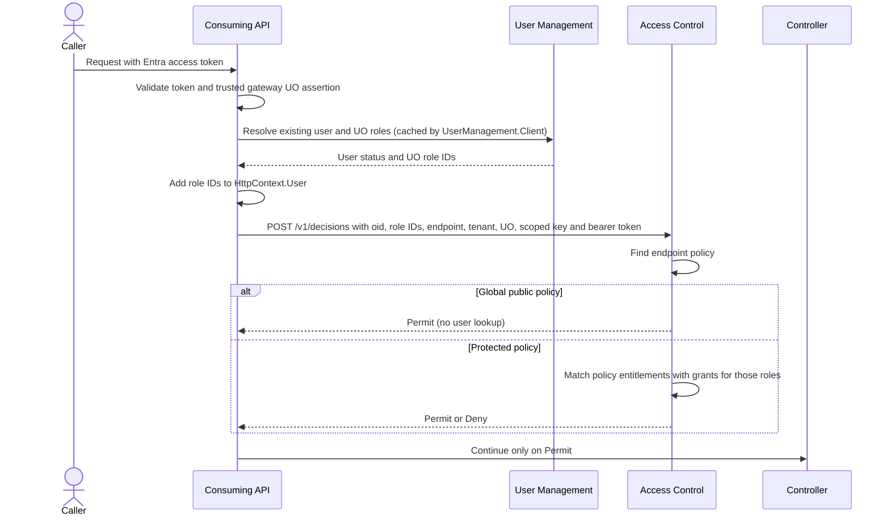

# Access Control and User Management

This .NET 10 repository contains two services and two reusable ASP.NET Core client packages. User Management owns users, unit organizations (UOs), business roles, UO membership, and SuperAdmin/UO Admin duties. Access Control owns endpoint policies and entitlements granted to stable role IDs. The administration frontend lives in another project.

## Request flow



The decision request contains the role IDs that User Management added to the consuming API's authenticated request. Access Control does not call User Management for ordinary decisions. A missing policy, inactive or deleted user, revoked UO membership, or inactive role is handled by User Management resolution; missing roles or entitlement grants deny a protected decision. Global public policies use the all-zero UO ID and need no role IDs. The User Management client cache is bounded, polls the User Management revision, and expires entries after at most five seconds. Access Control separately caches policies and grants.

`UserManagement.Client` resolves only existing users and UO memberships and enriches `HttpContext.User` with role IDs for Access Control and role codes for controller checks. An unknown user, UO, or membership is denied before Access Control. Administrators create UOs, users, memberships, and roles explicitly. A new user can start without roles or receive IDs of existing roles in the administrator create request. A newly assigned membership starts without roles. Administrators can later replace assigned roles with `PUT /v1/users/{objectId}/roles`. The consumer validates the gateway assertion before adding its `Gateway` identity. Plain UO headers are not trusted.

The remaining reads have separate purposes: User Management resolves existing user roles before the decision call; Access Control reads its own endpoint policy and role grants during that call; administrator operations check current management duties. Ordinary Access Control decisions do not request a user-role lookup from User Management.

## Administrator access

SuperAdmin is tenant-wide. UO Admin manages only assigned UOs and may be an ordinary user elsewhere. Only SuperAdmin assigns management duties, globally deletes or disables users, and changes global public policies. Both duties can manage users, roles, entitlements, and endpoint policies in their authorized scope. Revoking one UO membership leaves other memberships intact.

Administrator requests require a service-side administrator key and an Entra access token validated by the target service. Access Control asks User Management for the actor's current duties before an administrator action. The separate decision path uses a client credential scoped to configured modules, tenants, and UOs; a non-anonymous decision also requires a validated Entra bearer token whose `oid` matches `subjectId`. Keep service keys on the existing frontend's backend, never in browser JavaScript. Set `EntraAdmin:Authority` and `EntraAdmin:Audience` for both services; set `DecisionEntra:Authority` and `DecisionEntra:Audience` in Access Control for consuming API tokens. Configure compatible admin token audiences if Access Control forwards the admin token to User Management.

The services do not provision the first SuperAdmin. An existing SuperAdmin can make later assignments through the administrator REST API. The last active SuperAdmin cannot be disabled, deleted, or demoted through that API.

## Run locally

Use .NET 10 SDK and Docker. The Development settings contain example keys and local SQL Server connection strings; replace them for production. **These are new first-version migrations for fresh databases.** Existing databases with an older schema must be migrated separately; do not point Development auto-migration at one you need to preserve.

```powershell
dotnet dev-certs https --trust
docker compose up -d sqlserver
dotnet run --project src/UserManagement.Service --launch-profile http
dotnet run --project src/AccessControl.Service --launch-profile https
```

Run the two `dotnet run` commands in separate terminals. User Management Swagger is at `http://localhost:5220/swagger`; Access Control Swagger is at `https://localhost:7219/swagger`. Development startup applies the fresh EF migrations. `GET /health` is liveness; User Management also exposes `GET /ready` for database connectivity. The Docker SQL Server listens on `localhost,1433`; its persistent volume retains its original `sa` password even if the compose file later changes.

For a protected route, create a UO, user, membership, and role in User Management; assign the role ID to the user with `PUT /v1/users/{objectId}/roles`; create an entitlement in Access Control; grant that entitlement to the role ID with `PUT /v1/roles/entitlements`; and save an endpoint policy with `PUT /v1/policies`. A policy key uses the route **template**, such as `/customers/{id}`, not `/customers/123`. Administrator Swagger calls need both the admin key and a suitable Entra bearer token. The existing frontend backend can make those calls.

## Add the middleware packages to a consuming API

```powershell
dotnet pack src/UserManagement.Contracts -c Release -o artifacts/packages
dotnet pack src/UserManagement.Client -c Release -o artifacts/packages
dotnet pack src/AccessControl.Contracts -c Release -o artifacts/packages
dotnet pack src/AccessControl.Client -c Release -o artifacts/packages
```

Install both client packages and their matching contracts from the package source. Configure the consuming API to validate its Entra JWT, authenticate the trusted gateway UO assertion, and then order middleware as follows:

```csharp
builder.Services.AddAuthentication(/* validated Entra JWT */);
builder.Services.AddAuthorization();
builder.Services.AddUserManagement(builder.Configuration);
builder.Services.AddAccessControl(builder.Configuration);

app.UseRouting();
app.UseAuthentication();
app.UseUserManagement();
app.UseAccessControl();
app.UseAuthorization();
app.MapControllers();
```

Set `AccessControl:Module` and the two client `ServiceUrl`/`ApiKey` values. Give each consuming service its own Access Control decision key and configure `ApiKeys:DecisionClients` with that service's allowed modules, application tenants, and UOs. `AllowAnyUnitOrganization` must be explicitly enabled if a trusted service handles dynamically created UOs. The Access Control client forwards the original bearer token for authenticated decisions. The consuming API and Access Control must agree on its Entra authority and audience.

## Data and operation notes

Every persistence entity has a GUID `Id`, `LastUpdateUser` (max 200), and UTC `LastUpdateTime`. EF stamps tracked inserts and updates with the validated actor `oid`; writes without a validated actor fail. Bulk updates require and stamp the same actor. Migration seed rows use `Migration` as their update source. This update metadata is not an audit history. Join tables retain natural-key uniqueness constraints, and revision rows have fixed GUID IDs.

`IsActive` allows reversible disabling; `IsDeleted` is a tombstone. A revoked UO membership remains revoked on later sign-in, while other memberships remain. Deleted policies stop decisions after cache invalidation or the short fallback expiry. User Management owns roles and UO memberships; Access Control stores grants against stable role IDs without duplicating the user directory.

See [User Management API](docs/user-management-api.md), [Access Control API](docs/api-contract.md), [User Management OpenAPI](src/UserManagement.Service/wwwroot/openapi/user-management.v1.json), and [Access Control OpenAPI](src/AccessControl.Service/wwwroot/openapi/access-control.v1.json). Benchmark instructions are in [benchmarks/README.md](benchmarks/README.md); historical results predate the current forwarded role-ID flow and are not production capacity estimates.

```powershell
dotnet test AccessControl.sln -c Release
./scripts/verify-coverage.ps1
```

Tests use SQLite and in-process HTTP where noted. Validate the fresh migrations, revocation delay, Entra token configuration, and multi-instance load against a dedicated SQL Server staging deployment before production use. No migration or cleanup command in this README alters an existing database automatically except the Development startup migration when explicitly enabled.
