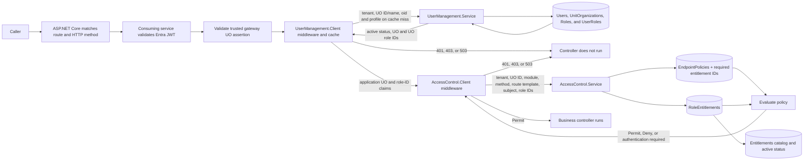

# Architecture

## User Management before authorization

`UserManagement.Service` owns a separate SQL Server database with tenant-scoped users keyed by `(TenantId, oid)`, unit organizations (UOs), UO-scoped roles with GUID IDs, and user-to-role assignments within each UO. The consuming host validates Entra JWTs and gateway assertions first. On a first delegated request, User Management can create the gateway-asserted UO and assign the user its `reviewer` role. `UserManagement.Client` adds UO, role-ID, and role-code claims to `HttpContext.User` for that request. `AccessControl.Client` reads only UO and role IDs from the dedicated User Management identity. User Management uses per-client and administrator credentials, a bounded five-second client cache keyed by tenant, UO, and oid, and a database revision polled after administrative changes. [API and client details](user-management-api.md).

## Access Control decision flow

The packages sit after host authentication, gateway validation, and route matching. Access Control reads the **route template** (`/customers/{id}`), not a concrete URL (`/customers/123`). There are no authorization attributes on controllers. The host owns token and gateway assertion validation. The consuming API forwards subject, UO ID, and role IDs from User Management together with tenant, module, method, and route template. The services do not call one another. Access Control trusts the consuming API's assertions and should use scoped workload credentials before accepting mutually untrusted callers.

Role disabling is enforced when User Management resolves the user: it stops returning that role ID. Access Control does not independently fetch role status, so a consuming API with a still-cached resolution can forward the old ID until its cache expires or observes the revision. Only trusted consuming APIs may call the decision endpoint.

`Entitlements` is a tenant- and UO-scoped catalog with stable GUID IDs, unique codes, display names, and active status. `EndpointPolicies` has one row per `(TenantId, UnitOrganizationId, Module, HttpMethod, RouteTemplate)` with `IsPublic`; `EndpointPolicyEntitlements` references catalog IDs. `RoleEntitlements` grants catalog IDs to `(TenantId, UnitOrganizationId, RoleId)`; it has no user columns. Composite foreign keys prevent a grant or requirement from referencing an entitlement in another scope. A policy permits when at least one required ID is among the caller's active role grants in that scope. The all-zero UO ID is reserved for a global public policy, used by anonymous callers and as a fallback when no UO-specific policy exists. A UO-specific policy takes precedence. No policy means Deny.

The initial Access Control migration creates the catalog, endpoint policy tables, ID-based grant tables, and a shared `AuthorizationRevisions` row. Provision entitlements, grants, and endpoint policies before adopting the middleware.

Each service has a single initial migration for a fresh database. User Management creates tenant-scoped users and UOs and UO-scoped roles with generated role IDs and active status; Access Control stores policy and role grants by entitlement IDs and UO ID. No legacy string-role or entitlement data is copied. Role codes are unique per UO and display names may repeat. User Management enforces that assigned role IDs belong to the user's tenant and UO; Access Control has no cross-database foreign key to its role catalog. Disabling a role removes it from new user resolutions without deleting assignments. Disabling an entitlement removes its effect on decisions without deleting grants or policies. Deleting a UO tombstones its ID, retaining referenced rows for audit while blocking resolution and role assignment. Access Control policy and grant rows for that ID require separate cleanup. Already cached resolutions may remain effective for up to five seconds.

Each service instance holds a bounded, five-second cache of policy rows and role grant sets. Concurrent misses for the same key share one database load. Access Control catalog, policy, and grant writes update the authorization revision in the same transaction and clear the local cache; User Management role status writes update its own revision and clear resolution caches. Other instances poll revisions every second and clear their caches when they change. Entry expiration is the five-second fallback if a poll fails or an out-of-band database write does not advance the revision. This defines the accepted revocation delay: up to five seconds for already cached inputs, except a request already in flight. The cache stores policy and grant data, not per-user Permit decisions.

If SQL Server becomes unavailable, an entry already in cache can still be used until it expires. After expiration, the database load fails and the consuming middleware returns `503`; the cache does not extend expired grants during an outage.

| Situation | Result |
| --- | --- |
| Matched public endpoint with public policy | Continue, including anonymous callers |
| Protected endpoint, caller not authenticated | `401` |
| Protected endpoint, matching role entitlement | Continue |
| Protected endpoint, no matching entitlement | `403` |
| Matched endpoint without policy, authenticated caller | `403` |
| Matched endpoint without public policy, anonymous caller | `401` |
| Decision service unavailable or invalid response | `503` |
| Route not matched by ASP.NET Core | Host handles `404` |
| Path explicitly in local `ExcludedPaths` | Continue without central decision |

The optional endpoint catalog exports discovered HTTP methods and route templates. Compare it against policies during deployment to find missing or obsolete entries. It does not approve endpoints automatically. Keep `ExcludedPaths` limited to infrastructure paths such as `/health`.

Structured logs record endpoint identity, tenant, decision, counts, API status, and trace ID. They avoid subject IDs and keys. The model is role and entitlement based; it does not evaluate record ownership or ALFA/XACML rules. For production, restrict service network access, secure decision and admin keys separately, run migrations before traffic, and monitor `403` missing-policy and `503` dependency errors.
