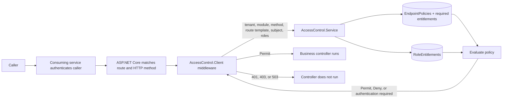

# Architecture

The package sits after host authentication and route matching. It reads the **route template** (`/customers/{id}`), not a concrete URL (`/customers/123`). There are no authorization attributes on controllers. The host owns token validation. The client sends trusted identity claims, role claims, tenant, module, method, and route template to the service. The service owns policies and grant evaluation.

`EndpointPolicies` has one row per `(TenantId, Module, HttpMethod, RouteTemplate)` with `IsPublic`. `EndpointPolicyEntitlements` holds its allowed entitlement alternatives. `RoleEntitlements` grants entitlements to roles within a tenant. A policy permits when at least one required entitlement is in the union of the caller's role grants. A public policy permits without authentication. No policy means Deny.

The EF migrations add the endpoint policy tables and a shared `AuthorizationRevisions` row, while preserving legacy `AccessPolicies`; old rows have no effect on endpoint decisions. Provision new endpoint policies before adopting the middleware.

Each service instance holds a bounded, five-second cache of policy rows and role grant sets. Concurrent misses for the same key share one database load. An administration write updates the revision in the same transaction as the policy or grant change, then clears the local cache. Other instances poll the revision every second and clear their caches when it changes. Entry expiration is the five-second fallback if a poll fails or an out-of-band database write does not advance the revision. This defines the accepted revocation delay: up to five seconds for already cached inputs, except a request already in flight. The cache stores policy and grant data, not per-user Permit decisions.

If SQL Server becomes unavailable, an entry already in cache can still be used until it expires. After expiration, the database load fails and the consuming middleware returns `503`; the cache does not extend expired grants during an outage.

| Situation | Result |
| --- | --- |
| Matched public endpoint with public policy | Continue, including anonymous callers |
| Protected endpoint, caller not authenticated | `401` |
| Protected endpoint, matching role entitlement | Continue |
| Protected endpoint, no matching entitlement | `403` |
| Matched endpoint without policy | `403` |
| Decision service unavailable or invalid response | `503` |
| Route not matched by ASP.NET Core | Host handles `404` |
| Path explicitly in local `ExcludedPaths` | Continue without central decision |

The optional endpoint catalog exports discovered HTTP methods and route templates. Compare it against policies during deployment to find missing or obsolete entries. It does not approve endpoints automatically. Keep `ExcludedPaths` limited to infrastructure paths such as `/health`.

Structured logs record endpoint identity, tenant, decision, counts, API status, and trace ID. They avoid subject IDs and keys. The model is role and entitlement based; it does not evaluate record ownership or ALFA/XACML rules. For production, restrict service network access, secure decision and admin keys separately, run migrations before traffic, and monitor `403` missing-policy and `503` dependency errors.
